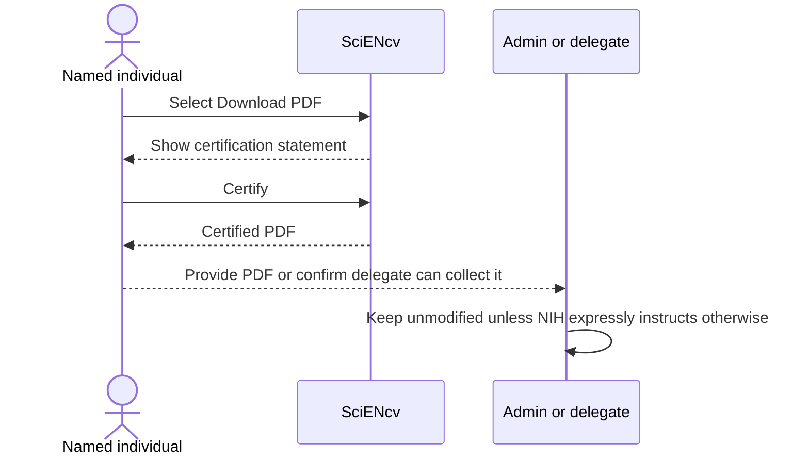

# Certify + download (individual-only step)

{: .warning }
> **September 2026 certificate alert:** Before reusing an older PDF, check the [signing-certificate alert and re-certification steps]({{ site.baseurl }}). A certification less than 12 months old can still be affected.

{: .warning }
> **Certify in your own account.** The person named on the biosketch must sign in and select **Certify** themselves. Do not share your password, verification codes, or signed-in session so someone else can certify. Staff can prepare the form through [delegated access]({{ site.baseurl }}).

1. Use **View Draft** to review the completed form.
2. Select **Download PDF** to open the certification dialog.
3. Read the certification statement and select **Certify**. SciENcv then downloads the certified PDF.

See [NIH's individual certification requirement](https://grants.nih.gov/grants/guide/notice-files/NOT-OD-26-018.html) and the [illustrated SciENcv certification instructions](https://www.ncbi.nlm.nih.gov/sites/books/NBK154494/#sciencv.Certifying_and_Downloading_SciEN).

{: .warning }
> Do **not** Print to PDF / “Optimize” / flatten this file by default. Submit the SciENcv-generated PDF as-is unless the NIH Application Guide or NOFO expressly requires a special compiled/flattened attachment, such as participating-faculty biosketches.

{: .note }
> You **may rename the downloaded PDF file** to match NIH filename guidance, but do **not** alter the PDF content. If the document changes, or if the certification/signature date is more than **12 months** old at submission time, update it in SciENcv, **re-certify**, and download a fresh PDF.

## Application research-security check

For NIH applications:

- each senior/key person must have completed qualifying Research Security Training (RST) within the **12 months before application submission**;
- the person certifies completion through the SciENcv biosketch; and
- the AOR provides a separate institutional certification through the application signature for each covered individual employed by the applicant organization.

The biosketch certification also includes the individual malign foreign talent recruitment program (MFTRP) attestation. See [Research-security certifications]({{ site.baseurl }}) for application and RPPR requirements.

{: .note }
> If a saved form does not include the required RST and MFTRP certifications, regenerate and re-certify it in the current SciENcv interface.

