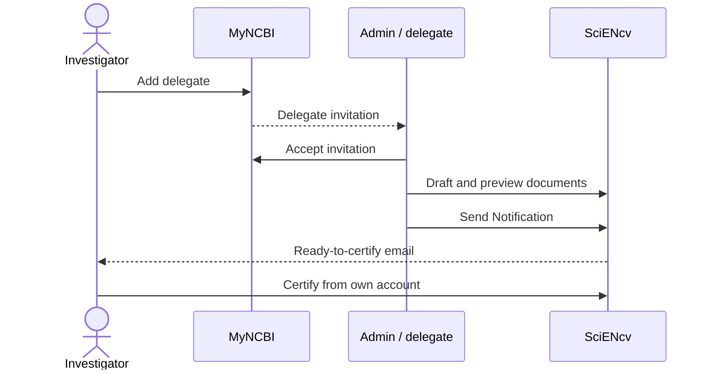

# Delegates (how to collaborate)

## Investigator: add a delegate

In My NCBI, open **Account Settings → Delegates → Add a delegate**, then enter the delegate's email address and save.

## Admin: accept the invite

Sign in to **your own** My NCBI account and accept the email invitation.

## What delegates can and can’t do

Delegates can:
- Create and edit SciENcv documents
- Import data and curate Products
- Paste narratives, format entries, run previews

{: .warning }
> **Only the person named on the form can certify it.** Keep passwords, verification codes, and signed-in sessions private. Staff must use their own accounts through SciENcv delegation for drafting and review. They cannot sign in as the investigator or certify on the investigator's behalf.

When the document is ready, the delegate can select **Download PDF**, then **Send Notification** to email the account owner. The named individual signs in, reviews the form, and certifies it.

See [My NCBI Help for SciENcv](https://www.ncbi.nlm.nih.gov/sites/books/NBK154494/), [NCBI account security guidance](https://ncbiinsights.ncbi.nlm.nih.gov/my-ncbi-login-transition-tips/), and [NIH's Common Forms implementation notice](https://grants.nih.gov/grants/guide/notice-files/NOT-OD-26-018.html).

Next: [Certify + download (individual-only step)]({{ site.baseurl }})
