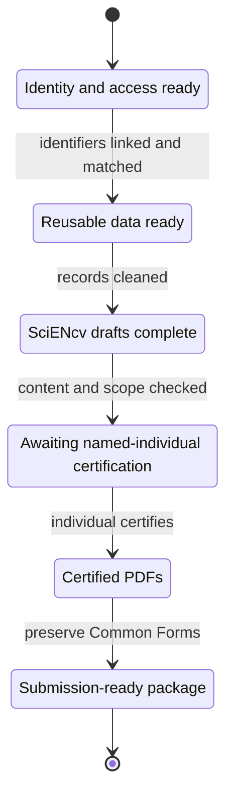

# NIH Common Forms (SciENcv) Playbook

Use this playbook to prepare NIH forms in SciENcv, whether you are an investigator, another person named on a form, or the staff member helping prepare it.

- **NIH biosketch:** Biographical Sketch Common Form and NIH Biographical Sketch Supplement
- **Current and Pending (Other) Support (CPOS):** a separate Common Form

This independent guide links to the official instructions in [References]({{ site.baseurl }}).

{: .warning }
> **Use certified SciENcv PDFs.** eRA validation stops submissions that lack compliant forms. Check [which forms to attach at each submission stage]({{ site.baseurl }}) and [who must complete the research-security certifications]({{ site.baseurl }}).

## Choose your quickstart

- [PI / faculty (15-minute checklist)]({{ site.baseurl }})
- [Administrator / delegate (fast checklist)]({{ site.baseurl }})
- [Co-I / key personnel (fast checklist)]({{ site.baseurl }})

{: .warning }
> **Reusing a saved SciENcv PDF?** Check whether the [September 2026 signing-certificate rollover]({{ site.baseurl }}) affects your attachment.

## Prepare and certify your forms

Check that the ORCID iD linked in eRA Commons matches the persistent identifier on the SciENcv form. Allow time for each person named on a form to review and certify it in their own account.

See the [complete walkthrough]({{ site.baseurl }}) for the steps from account setup through submission.
