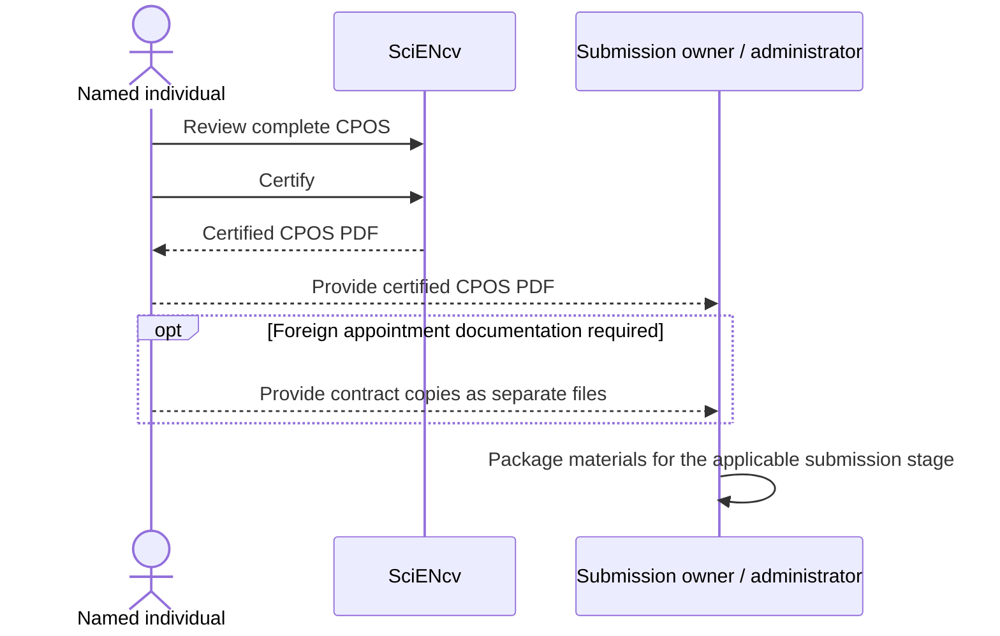

# Certify + download CPOS (individual-only)

{: .warning }
> **September 2026 certificate alert:** Before reusing an older PDF, check the [signing-certificate alert and re-certification steps]({{ site.baseurl }}). A certification less than 12 months old can still be affected.

When CPOS is required for the person and submission stage, use the same individual-certification pattern as the biosketch:

1. Sign in to your own SciENcv account and open the completed CPOS form.
2. Select **Download PDF** to open the certification statement.
3. Review the statement and select **Certify** to download the certified PDF.

{: .warning }
> **The named individual must certify.** Keep your password, verification codes, and signed-in session private. Give staff drafting access through [SciENcv delegation]({{ site.baseurl }}).

{: .warning }
> Keep the certified CPOS PDF unmodified unless the NIH Application Guide or NOFO expressly requires otherwise. Do not print/flatten it merely to combine it with another person’s form or with supporting documentation.

{: .note }
> You **may rename the downloaded PDF file** to match NIH filename guidance, but do **not** alter the PDF content. If the document changes, or if the certification/signature date is more than **12 months** old at submission time, update it in SciENcv, **re-certify**, and download a fresh PDF.

{: .note }
> If NIH requires **supporting documentation** for foreign appointments/employment reported in CPOS, flatten the contract copies and attach them **separately** in the relevant **eRA JIT, RPPR, or Prior Approval** module. Do **not** append them to the SciENcv CPOS PDF.

{: .note }
> The current CPOS certification text includes RST and MFTRP attestations. For NIH applications, NIH collects the individual RST certification through the biosketch because CPOS is ordinarily not collected at application. When a separate RPPR MFTRP statement is required, it is a **separate attachment**, not part of CPOS. See [Research-security certifications]({{ site.baseurl }}) for the current FAQ/guide conflict.

