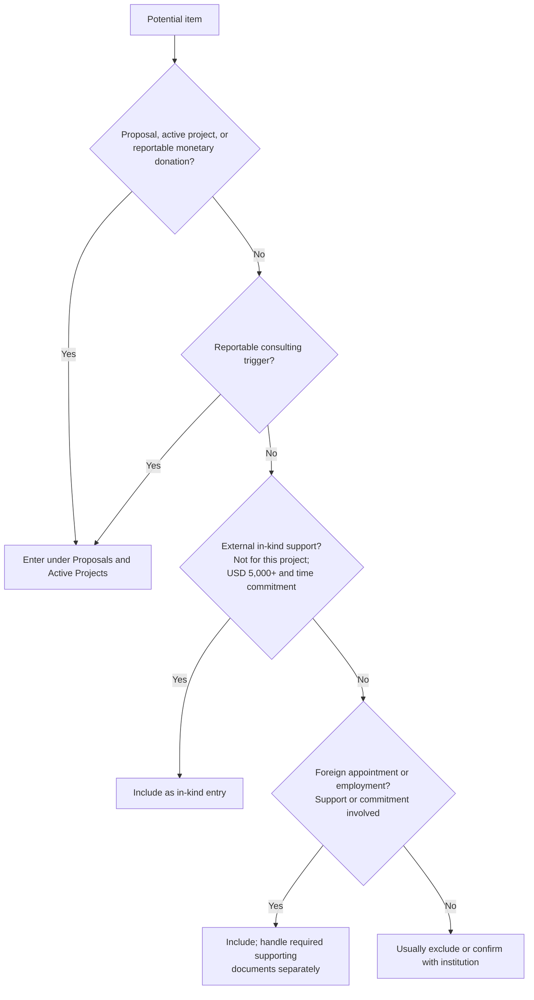

# What to include (practical guidance)

Treat CPOS as a **complete disclosure record** for resources and commitments that NIH says must be reported. Institution policies vary; always confirm with your sponsored programs office.

{: .note }
> NIH recipients must provide Other Support disclosure training to all faculty and researchers identified as senior/key personnel, in addition to maintaining a written and enforced disclosure policy. Follow your institution's training and disclosure process. This requirement is separate from **Research Security Training (RST)**.

## Include these categories

### 1) All proposals and active projects

Disclose all current and pending proposals/projects that NIH expects in CPOS, including support from domestic and foreign entities. Prepare a **separate entry** for each proposal/active project and for each reportable in-kind contribution.

### Monetary donations for a named investigator’s research

Disclose a monetary donation received within the **past year** when it funds a named senior/key person’s ongoing research and the donor directs how the funds should be used and requests scientific or financial updates. NIH also gives a reportable example where the donor verbally directed funds to specific research and the example omits any update request. Ask your sponsored programs office about directed donations with unclear terms. A gift for a research area that the institution allocates on its own is generally excluded. [NIH examples](https://grants.nih.gov/sites/default/files/monetary-donations-requiring-disclosure-example-scenarios.pdf), [FAQs on monetary donations](https://grants.nih.gov/faqs#/common-forms-biographical-sketch-current-pending-support.htm?anchor=12040).

Enter reportable donations as **Current** in **Proposals and Active Projects**. Use the donor’s primary location, the receipt month, the estimated end month of the supported activities, the amount received to date, and **0 person-months**. Describe the donor’s expectations and any overlap with active or pending NIH-funded projects. [NIH field instructions](https://grants.nih.gov/faqs#/common-forms-biographical-sketch-current-pending-support.htm?anchor=58060).

### 2) Reportable consulting activities

Include consulting under the **proposals / active projects** section when **any** of these NIH triggers apply:

- The consulting activity requires you to **perform research**
- The consulting activity is **not research**, but is related to your research portfolio and could affect **funding, time/effort commitments, or scientific integrity**
- The consulting contract requires you to **conceal or withhold financial or other ties** to the entity

### 3) In-kind contributions

Report non-cash contributions provided by an **external entity** that are **not intended for use on the project or proposal for which the disclosure is being submitted**, are valued at **$5,000 or more**, and require a commitment of the individual's time. Put resources intended for that project or proposal in **Facilities & Other Resources** or **Equipment**, as applicable. Do not treat broadly available institutional core facilities or shared equipment as CPOS in-kind support.

### 4) Foreign activities / appointments / employment

Include foreign appointments/employment/affiliations that imply commitment or support under NIH rules. If a foreign appointment and/or employment is reportable in CPOS, remember that **supporting documentation** (copies of contracts specific to those foreign appointments/employment arrangements) is **not appended inside SciENcv**. NIH says to attach that documentation **separately** in the relevant **eRA JIT, RPPR, or Prior Approval** module, with **translations** if the contract is not in English. The supporting-documentation requirement excludes **personal service contracts** and **employment contracts for fellows supported by foreign entities**; that exclusion does not by itself remove an otherwise reportable relationship from CPOS.

#### Foreign-component reporting and prior approval

Report foreign co-authorship on NIH-supported work to the funding NIH Institute or Center as soon as you become aware of it. If you expect a foreign collaboration to result in co-authorship, work with your institution to seek approval for the foreign component. Report any support, resources, appointments, or time commitments that meet the CPOS rules through the applicable CPOS workflow. [NIH Guide Notice NOT-OD-26-084](https://grants.nih.gov/grants/guide/notice-files/NOT-OD-26-084.html), [NIH co-authorship FAQ](https://grants.nih.gov/faqs#/Foreign-Collaborations-and-Components.htm?anchor=58032).

For an active award, check that the award permits foreign components and obtain NIH approval before significant project work such as new experiments or data analysis takes place abroad. NIH gives examples that do not require prior approval on their own, including minor edits to an existing draft after a move abroad and a review article limited to published work. If you already published with an undisclosed foreign collaborator, contact your NIH Program Officer and institutional research administration office promptly. [NIH scenarios](https://grants.nih.gov/sites/default/files/co-authorship-and-foreign-components-faqs-from-fdp-discussion-with-nih-extramural-leadership-sep.pdf), [NIH FAQ on review articles](https://grants.nih.gov/faqs#/Foreign-Collaborations-and-Components.htm?anchor=58045), [NIH FAQ on already-published work](https://grants.nih.gov/faqs#/Foreign-Collaborations-and-Components.htm?anchor=58048).

## Usually exclude these categories

- Broadly available institutional core facilities or shared equipment
- **Training awards**
- **Prizes**
- **True gifts** for which nothing is expected in return
- Personal information such as home address, personal phone, personal email, marital status, hobbies, or similar non-research data

Admin intake template:
- [Other Support (CPOS) intake form (admin worksheet)]({{ site.baseurl }})

If you are reusing prior Other Support records at scale, see:
- [XML Upload & Automation]({{ site.baseurl }})

