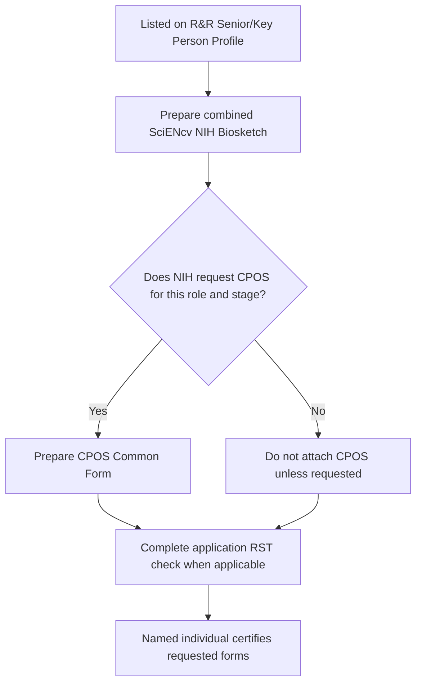

# Co-I / Key Personnel quickstart

Every person listed on the application’s **R&R Senior/Key Person Profile (Expanded)** needs a SciENcv-generated combined **NIH Biosketch**, including every **Other Significant Contributor (OSC)**. See [NIH Common Forms FAQ 57968](https://grants.nih.gov/faqs#/common-forms-biographical-sketch-current-pending-support.htm?anchor=57968) and [FAQ 57969](https://grants.nih.gov/faqs#/common-forms-biographical-sketch-current-pending-support.htm?anchor=57969). You will also need **CPOS / Other Support** when NIH requests it for your role, mechanism, and lifecycle stage.

{: .note }
> Two common exceptions to remember: **CPOS is not required for Other Significant Contributors (OSCs)**, and NIH generally does **not specifically request** CPOS for Program Directors, training faculty, and other oversight individuals in training grants. However, the NIH RPPR instructions treat **new training faculty added in a Training RPPR** as new senior/key personnel; for those individuals, upload the biosketch Common Form, NIH Supplement, CPOS, and any applicable supplemental documentation.

## Quick steps

1. Create an ORCID iD if you need one.
2. Link your ORCID iD to **eRA Commons** and confirm the same iD appears as the **Persistent Identifier (PID)** in SciENcv.
3. Review your **My Bibliography** entries for missing or incorrect citations.
4. Create the SciENcv documents yourself or work with your delegate.
5. If you are listed as senior/key personnel, complete qualifying **Research Security Training (RST)** within the 12 months before application submission. See [NIH's RST notice](https://grants.nih.gov/grants/guide/notice-files/NOT-OD-26-017.html).
6. **Certify and download each required PDF** from your own SciENcv account.

If you are faculty or a researcher identified as senior/key personnel at an NIH recipient institution, follow your institution's **Other Support disclosure training** process. This training is separate from RST.

For a Research Performance Progress Report (RPPR), use the [research-security certification guide]({{ site.baseurl }}) to check whether to provide a separate Section G.1 statement.

Next: [Biosketch overview (what you’re producing)]({{ site.baseurl }})
