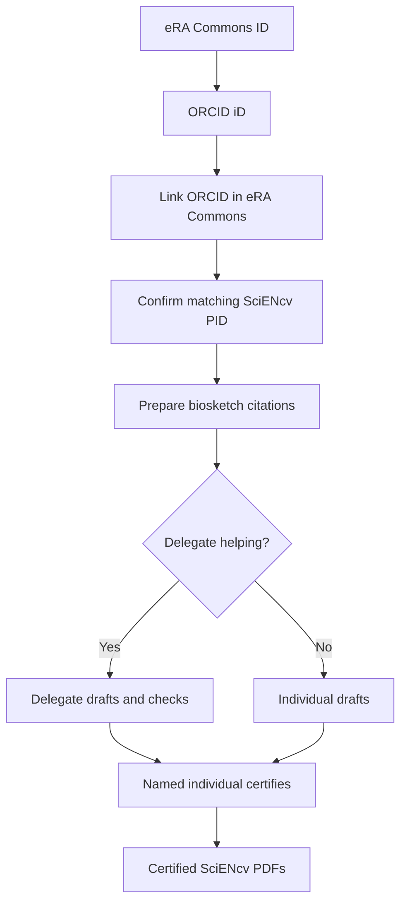

# Start Here

NIH uses SciENcv to generate digitally certified PDFs for the biosketch and Current and Pending (Other) Support (CPOS).

## From account setup to certified PDFs

1. Confirm you can sign in to eRA Commons and SciENcv. [Link your ORCID iD to eRA Commons and check the match in SciENcv]({{ site.baseurl }}).
2. Organize the citations you plan to use in the biosketch. [My Bibliography]({{ site.baseurl }}) is one source.
3. Prepare the required forms yourself or [give staff delegated access]({{ site.baseurl }}).
4. The person named on each form signs in and certifies it personally. Keep passwords and verification codes private and have staff use their own delegated accounts.

## Where to go next

- If you’re a PI: [PI / faculty quickstart]({{ site.baseurl }})
- If you’re a delegate/admin: [Administrator / delegate quickstart]({{ site.baseurl }})
- If you’re building department-wide support: [Submission planning & tracker]({{ site.baseurl }})
